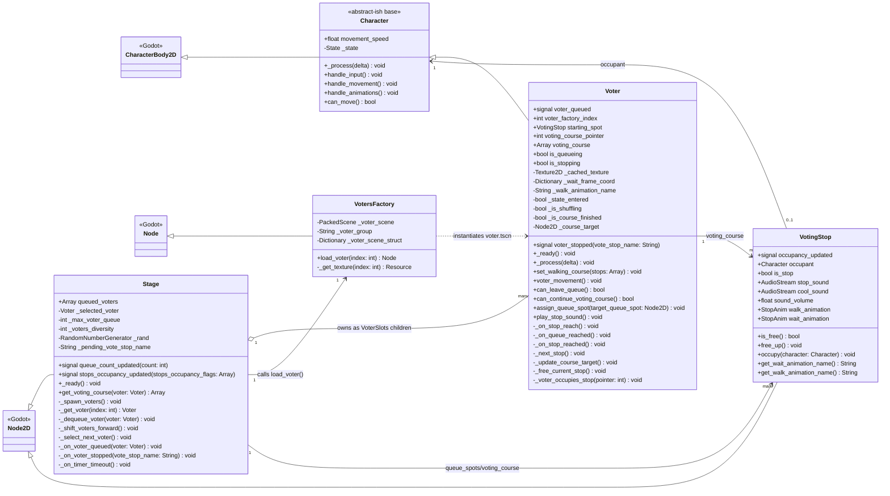
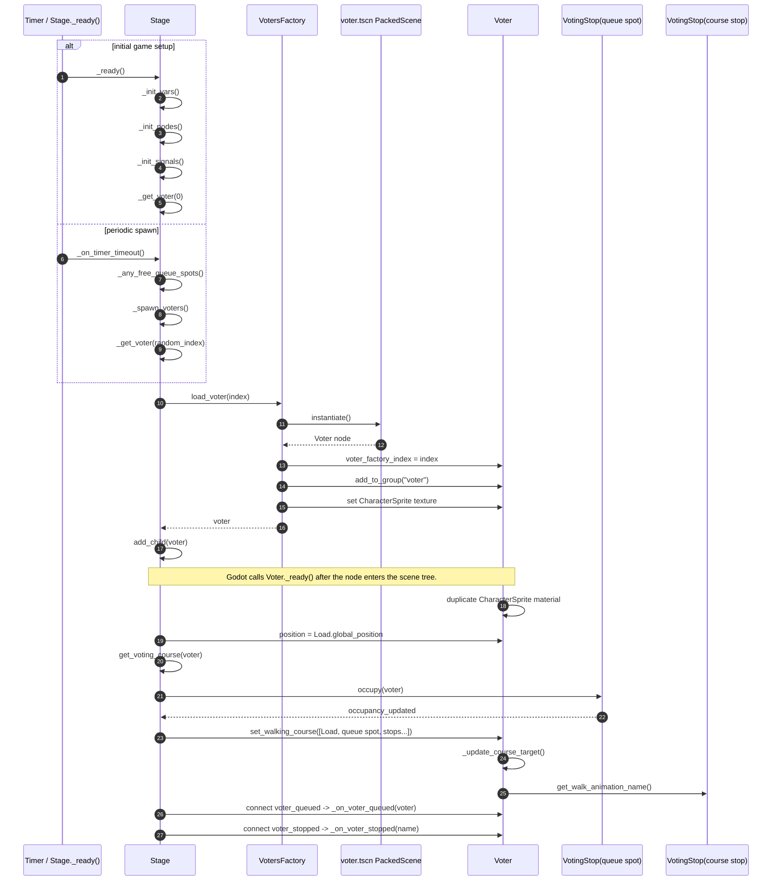
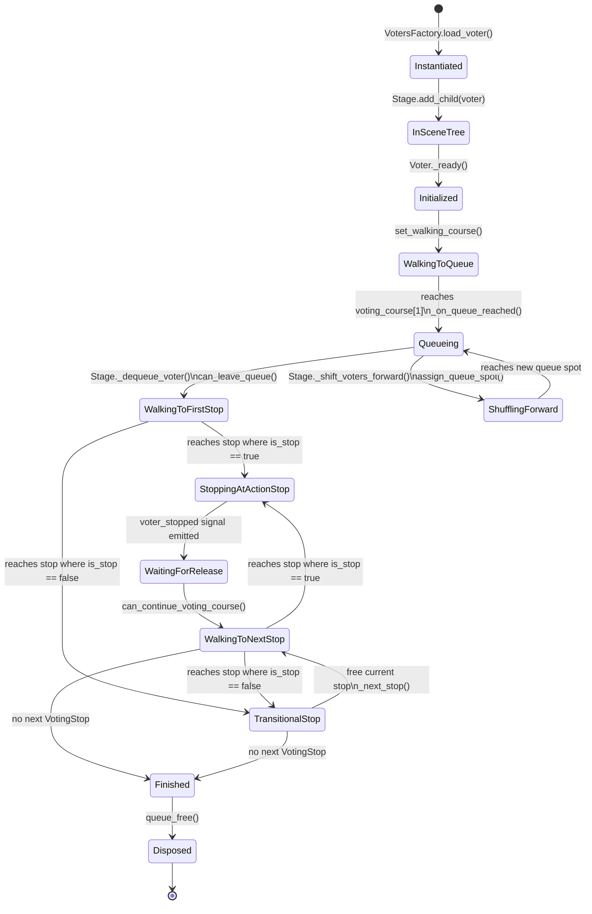

# Voter Lifetime UML

This document summarizes the lifetime of a voter actor as implemented in the Godot source. The diagrams focus on creation, active lifecycle, queue/stop interaction, and disposal.

Primary source files:

- `!project/build/design/scenes/actors/voter.gd`
- `!project/build/design/scenes/actors/voters.gd`
- `!project/build/design/scenes/stage.gd`
- `!project/build/design/scenes/scenery/voting_stop.gd`
- `!project/build/design/scenes/actors/character.gd`

## Class UML

## Creation / Instantiation Sequence

## Interaction Sequence: Queue, Stops, and Disposal

```mermaid
sequenceDiagram
    autonumber
    participant GameLoop as Godot frame loop
    participant Stage
    participant Voter
    participant QueueSpot as VotingStop(queue spot)
    participant Stop as VotingStop(course stop)
    participant Info as InfoDialog

    loop each process frame while active
        GameLoop->>Voter: _process(delta)
        alt queueing, stopping, finished, or no target
            Voter->>Voter: velocity = Vector2.ZERO
        else walking toward _course_target
            Voter->>Voter: voter_movement()
            Voter->>Voter: _on_stop_reach() when close enough
        end
        Voter->>Voter: Character._process(delta)
        Voter->>Voter: handle_movement()
        Voter->>Voter: handle_animations()
        Voter->>Voter: move_and_slide()
    end

    Voter->>Voter: reach Load at pointer 0
    Voter->>Voter: _next_stop()
    Voter->>Voter: _update_course_target(queue spot)

    Voter->>Voter: reach queue spot at pointer 1
    Voter->>Voter: _on_queue_reached()
    alt shuffling within queue
        Voter->>Voter: _is_shuffling = false
    else first queue arrival
        Voter->>Voter: is_queueing = true
        Voter->>Voter: starting_spot = queue spot
        Voter-->>Stage: voter_queued
        Stage->>Stage: queued_voters.append(voter)
        Stage-->>Stage: queue_count_updated(size)
    end

    Stage->>Voter: can_leave_queue()
    Voter->>Voter: _is_next_stop_free()
    Voter->>Stop: is_free()
    alt next stop is occupied
        Voter-->>Stage: false
    else next stop is free
        Voter->>Stop: occupy(voter)
        Stop-->>Stage: occupancy_updated
        Voter->>Voter: is_queueing = false
        Voter->>Voter: _next_stop()
        Voter-->>Stage: true
        Stage->>Stage: queued_voters.erase(voter)
        Stage->>QueueSpot: free_up()
        QueueSpot-->>Stage: occupancy_updated
        Stage->>Stage: _shift_voters_forward()
    end

    loop each voting course stop
        Voter->>Voter: reach course target
        Voter->>Voter: _on_stop_reached()
        Voter->>Stop: occupy(voter)
        Stop-->>Stage: occupancy_updated
        alt stop.is_stop == true
            Voter->>Voter: is_stopping = true
            Voter-->>Stage: voter_stopped(stop.name)
            Stage->>Stage: _pending_vote_stop_name = stop.name
            opt player opens info
                Stage->>Info: show_info(stop.name)
                Info-->>Stage: dialog_closed
            end
            Stage->>Voter: can_continue_voting_course()
            Voter->>Voter: _is_next_stop_free()
            Voter->>Stop: free_up()
            Stop-->>Stage: occupancy_updated
            Voter->>Voter: is_stopping = false
            Voter->>Voter: _next_stop()
        else transitional stop
            Voter->>Stop: free_up()
            Stop-->>Stage: occupancy_updated
            Voter->>Voter: _next_stop()
        end
    end

    Voter->>Voter: _update_course_target()
    alt voting_course_pointer is past final stop
        Voter->>Voter: _course_target = null
        Voter->>Voter: _is_course_finished = true
        Voter->>Voter: velocity = Vector2.ZERO
        Voter->>Voter: queue_free()
        Note over Voter: Godot queues the node for deletion at the end of the frame.
    end
```

## State / Lifetime UML

## Lifecycle Notes

- Voters are not constructed with `Voter.new()` in the game flow. They are instantiated from `voter.tscn` by `VotersFactory.load_voter()`.
- `Stage._get_voter()` owns the setup after instantiation: it adds the voter to `VoterSlots`, positions it at `Load`, builds its `voting_course`, connects signals, and starts movement by calling `set_walking_course()`.
- Queue positions and course stops are both represented by `VotingStop` nodes. They track occupancy through `occupy()` and `free_up()`, then emit `occupancy_updated`.
- The voter controls its own path progression with `voting_course_pointer` and `_course_target`.
- User input does not move a voter directly. `Stage` selects a queued/stopped voter, then calls either `can_leave_queue()` or `can_continue_voting_course()`.
- Disposal is internal to `Voter._update_course_target()`: when `voting_course_pointer` moves beyond the available course, `_is_course_finished` is set and `queue_free()` schedules the node for deletion.
