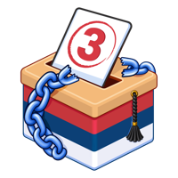

## Glasalica

|  | Mobilna i web igra o proceduri glasanja u Srbiji. Birači jedan po jedan prolaze kroz korake na biračkom mestu, a ti prepoznaješ greške — poštuješ pravila i dobijaš bodove, kršiš pravila: gubiš bodove i ispadaš ćaci. Koliko grešaka možeš da prepoznaš? |
|:--------------------------------:| ---------------------------------------------------------------------------------------------------------------------------------------------------------------------------------------------------------------------------------------------------------- |

*Glasalica je igra, a ne pravni izvor. Njena primarna svrha je zabava.*

#### Instalacija
- **iOS** — App Store: <https://apps.apple.com/us/app/glasalica/id6817350823>
- **Android** — Google Play: <https://play.google.com/store/apps/details?id=org.itblokada.glasalica>\
  AKO NE USPE, instaliraj iz APK datoteke:
  1. Na telefonu preuzmi APK: <https://github.com/kreativna-blokada/blokadna-glasalica/releases/download/v1.1.0/blokadna-glasalica-1.1.0.apk>
  2. Otvori preuzetu datoteku i izaberi *Instaliraj*.
  3. Ako telefon zatraži, dozvoli instaliranje aplikacija iz ovog izvora (pregledač ili datoteke).
  4. Ako se pojavi upozorenje Google Play zaštite, izaberi *Više detalja → Ipak instaliraj*.
- **Web** — igraj u pregledaču na itch.io: <https://kreativna-blokada.itch.io/glasalica>

#### Implementacija
- Otvorena za doprinos: <https://github.com/kreativna-blokada/blokadna-glasalica>
